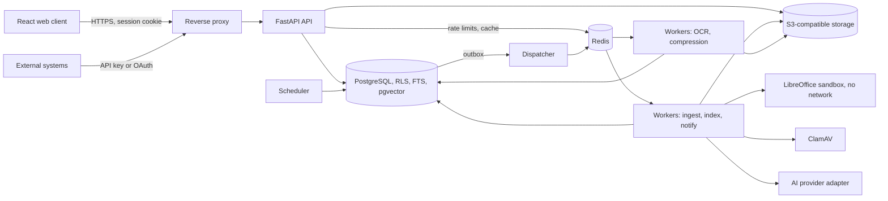

# DocuFlow implementation plan

**Status:** Accepted on 2026-11-06, with all defaults | **Current milestone:** M1, M0 passed on 2026-11-07

This is the entry point for reviewing Phase 0. It covers what will be built, in what order, where the plan departs from the source documents, and what needs a decision.

| Read next | Purpose |
|---|---|
| [Decisions](#1-decisions) | What the owner decided |
| [ADR index](adr/README.md) | 15 architecture decisions |
| [Domain model](architecture/domain-model.md) | Entities, relationships and permission resolution |
| [Feature matrix](FEATURE_MATRIX.md) | F01 to F22 status tracker |

Sources: *DocuFlow Developer Master Build Guide* v1.0 ("the guide") and *Feature-by-Feature Functional Build Specification* v1.0 ("the spec").

---

## 1. Decisions

The owner accepted every default below on 2026-11-06. A later change gets a new ADR.

| # | Decision | Default | Why it matters |
|---|---|---|---|
| 1 | **Project location** | Move to `C:\dev\docuflow`, outside OneDrive | OneDrive would sync `node_modules` and `.venv` and can lock files mid-build. |
| 2 | **Git hosting** | GitHub with GitHub Actions | The CI pipeline is written for one host. Git must also be installed locally. |
| 3 | **Licence intent**: will DocuFlow be closed-source or sold or hosted for others? | Assume closed-source, so avoid AGPL libraries in the application | Decides PyMuPDF versus the alternative ([ADR 0008](adr/0008-document-processing-and-viewer.md)). Have counsel confirm. |
| 4 | **Object storage** | SeaweedFS behind an S3 adapter, subject to the M0 spike | MinIO community edition appears to be retired ([ADR 0006](adr/0006-object-storage-and-immutability.md)). |
| 5 | **Languages** for OCR and search | English and French first; Kinyarwanda measured on real samples | No Kinyarwanda Tesseract model was found. Accuracy is unknown until tested, and a model may need training. |
| 6 | **Where the data lives** and whether external AI is allowed | Hosted in Rwanda; external AI off by default, per tenant opt-in | Rwanda's Law 058/2021 restricts storing personal data abroad. Sending text to a foreign AI provider needs legal review. |
| 7 | **Performance targets** | See section 7 | Neither document sets numbers, so load tests would have nothing to pass or fail against. |
| 8 | **Quality-gate defaults** | See section 7 | Same gap for compression and OCR. |
| 9 | **Sample documents** | Synthetic generator only | The guide forbids production data unless authorised. Representative anonymised scans would give much better OCR and compression evidence. |
| 10 | **External providers** (e-signature, ERP/CRM, Microsoft 365 tenant, SMTP) | Build adapters; test against contract simulators; list as external dependencies | Real end-to-end proof needs the owner's accounts. Can wait until F14 and F20. |
| 11 | **How compression reclaims storage** | Move originals of accepted documents to a cheaper archive tier, by policy; report both figures | Keeping every original and adding a derivative *increases* total storage. See section 3. Can wait until F17. |

---

## 2. Where this plan departs from the documents

The owner accepted these departures. Everything else follows the documents as written.

| Document says | Plan does | Reason |
|---|---|---|
| MinIO for local storage | SeaweedFS (candidate) behind the same S3 interface | Reports say MinIO stopped publishing community images and archived the repository in 2026. Dates differ between sources; check before deciding. |
| PyMuPDF for PDF work | pypdfium2 and pikepdf, **if** decision 3 stays closed-source | PyMuPDF is AGPL or paid commercial. If AGPL is acceptable, keep PyMuPDF, as it is simpler. |
| PDF viewer with thumbnails and highlighting | Viewer shows server-rendered page images with a text overlay; it never sends the PDF to the browser | Sending the PDF would make every previewer a downloader, breaking "download is blocked for a user without download permission" (F05). |
| Strict F01 to F22 order | Same order, but audit, jobs, storage and permissions start in M0 | Every feature depends on them (section 5). |

---

## 3. Conflicts inside the documents, and how they are resolved

| Conflict | Resolution |
|---|---|
| Guide wants automatic classification; spec's critical requirement says fields fill "once I select a document type" | Classification proposes a type. A user's selection overrides it and re-runs extraction for that type. Auto-filing happens only under the high-confidence policy. |
| "Originals are immutable" versus "defensible disposal" and lawful erasure | Immutable means never changed. Authorised disposal may destroy the object and leaves a permanent event record ([ADR 0015](adr/0015-retention-disposal-and-immutability.md)). |
| "Immediately preserve the original" versus "malware scanning before release" | The binary is stored encrypted in `quarantined` state straight away and cannot be read until scanning passes. |
| Hash-based deduplication versus disposal | Deduplication works within a tenant only. Bytes are destroyed only when no live version references them. |
| "No mock-only features" versus providers we have no account for | Adapters are real code. Simulators live only in test code and are never selectable in production. Unconnected adapters show as "not configured", never as working. |
| "Deterministic fallback" versus "AI assistant" | With no LLM, the assistant returns cited extracts, labelled as extracts. It does not pretend to generate an answer. |
| WORM object lock versus legal disposal | Lock duration comes from the retention class, never exceeding it. Object lock remains optional. |
| F17 promises "storage is reduced", but originals must always be preserved | Original plus derivative uses more space, not less. Savings only appear on a cheaper tier or through delivery. Reports show derivative reduction and storage actually reclaimed as separate figures (decision 11). |

---

## 4. Architecture

A modular monolith: one deployable backend with enforced module boundaries, running as API and worker processes ([ADR 0001](adr/0001-modular-monolith.md)).



Repository layout:

```text
docuflow/
├─ backend/
│  ├─ src/docuflow/
│  │  ├─ platform/      config, db, tenancy, audit, jobs, storage, crypto, observability
│  │  └─ modules/       identity, repository, documents, capture, processing, indexing,
│  │                    search, tasks, workflows, forms, notifications, signatures,
│  │                    retention, compression, ai, integrations, backup, admin
│  │                    (each: models, schemas, services, api, jobs, tests)
│  ├─ migrations/       Alembic
│  └─ tests/            cross-module, permission matrix, security
├─ frontend/            Vite, React, TypeScript; API client generated from OpenAPI
├─ deploy/              compose profiles, Dockerfiles, Helm chart
├─ samples/             synthetic document generator and ground truth
├─ e2e/                 Playwright journeys, load tests
└─ docs/                ADRs, architecture, guides, runbooks, reports
```

---

## 5. Delivery milestones

Each milestone ends with a gate: tests pass, acceptance demo runs from a clean install, matrix updated, feature report written. The owner reviews at each gate.

| Milestone | Scope | Gate |
|---|---|---|
| **M0 Foundation** | Repo, compose, CI, config, RLS, migrations, audit writer, job framework, storage adapter and spike, correlation IDs, sample generator | Clean `docker compose up`; RLS and job-recovery tests pass. No feature is marked done. |
| **M1 Secure filing** | F01, F02 | Finance and HR isolation demo; role change takes effect immediately |
| **M2 Ingest and index** | F03, F04, F05, F06, F07 | Scanned invoice auto-OCRs, fields fill with confidence and source page, correction audited |
| **M3 Retrieval** | F08, F09 | The "supplier ABC due in November" query returns authorised pages only |
| **M4 Process** | F10, F11, F12, F13, F14 | Scenario A end to end, including rejection and SLA escalation |
| **M5 Governance** | F15, F16 | Scenario E; audit tampering detected |
| **M6 Optimise and AI** | F17, F18 | Scenarios D and F; compression report |
| **M7 Operate** | F19, F20, F21, F22 | All scenarios from a clean Linux machine; restore drill; release checklist |

**No dates are given.** The documents do not fix a team or schedule, and M2 and M4 are the largest milestones. Progress is reported by gate, not by promised date.

**Foundations that start early, and when they finish:**

| Capability | Starts | Finishes |
|---|---|---|
| Audit writer and hash chain | M0 | F16 adds viewer, export and verification tools |
| Job framework | M0 | F19 adds the job monitor |
| Permission engine | F01 | Extended as each new resource type arrives |
| In-app notifications | F10 | F13 adds SLA, email and delivery tracking |

**Sequential order leaves these criteria open at first.** The matrix records these as *Done, link pending* rather than Done:

| Feature | Requirement that needs a later feature |
|---|---|
| F02 | Cabinet retention policy needs F15; auto-routing needs F07 and F11 |
| F03 | Email ingestion completes with F20 |
| F05 | Audit timeline view needs F16 |
| F09 | Compressed derivative in the demo needs F17 |

---

## 6. This machine's limits

| Constraint | Effect | Plan |
|---|---|---|
| 7.8 GB RAM | Full stack may not fit alongside the OS | Compose profiles: `core` always; `scan`, `ai-local`, `obs` on demand. Containers get memory caps. |
| Local LLMs | Unlikely to run usefully here | Local embeddings are small. A local LLM stays optional for larger hardware. |
| Windows host | F22 requires "a clean Linux machine" | CI Linux runners provide this evidence. |
| Single laptop | Load tests would not represent production | Run them on owner-provided hardware; publish results with hardware details. |

The idle core stack measured about 655 MiB in CI ([M0 gate report](reports/m0-gate.md)). OCR and real documents will raise this. Local Docker cannot start on this laptop yet, so the gates run on CI.

---

## 7. Proposed numeric targets

These are starting proposals. All are configurable.

| Area | Proposed target |
|---|---|
| Design volume | 1 million documents, 200 concurrent users per deployment |
| Keyword search | p95 under 500 ms at design volume |
| Hybrid search | p95 under 1.5 s |
| Upload acknowledged | Under 2 s after transfer, regardless of processing time |
| OCR baseline | At least 95% character accuracy on the clean synthetic set |
| Auto-accept confidence | 0.90 or above, and validation passes |
| Human review band | 0.60 to 0.89; below 0.60 requires correction |
| Compression gate, text pages | SSIM 0.97 or above; OCR accuracy drop 1 point or less |
| Compression gate, photographic pages | SSIM 0.92 or above |
| Backup restore | RPO 24 h, RTO 4 h, verified by drill |

---

## 8. Top risks

| Risk | Mitigation |
|---|---|
| Scope: 22 full vertical slices | Gates after each milestone; the owner can reprioritise at any gate |
| OCR and extraction accuracy on real local documents | Measure early in M2; adapter design allows engine changes |
| Permission leak through a secondary path (OCR text, thumbnails, embeddings, AI) | One policy service plus a generated matrix test covering every document-reading endpoint |
| Storage replacement lacks a needed feature | M0 spike runs an S3 conformance test before commitment |
| Compliance overclaim | Controls are mapped to standards; the product never claims certification. Legal review is outside this project. |

---

## Sources for the research

- [MinIO CE in 2026: retired upstream, source-only](https://glukhov.org/data-infrastructure/object-storage/minio-dead/)
- [MinIO moves away from open source (It's FOSS)](https://itsfoss.com/news/minio-moves-away-from-open-source/)
- [Self-hosted S3 alternatives in 2026](https://glukhov.org/data-infrastructure/object-storage/self-hosted-s3-alternatives/)
- [PyMuPDF licensing on PyPI](https://pypi.org/project/PyMuPDF/1.19.2/)
- [pypdfium2 on PyPI](https://pypi.org/project/pypdfium2/3.21.0/)
- [pgvector 0.8.0 release notes](https://www.postgresql.org/about/news/pgvector-0.8.0-released-2952/)
- [DLA Piper: data protection in Rwanda](https://www.dlapiperdataprotection.com/?c=RW&t=law)
- [PwC Rwanda: cross-border data transfer](https://www.pwc.com/rw/en/assets/pdf/legal-alert-navigating-cross-border-data-transfer.pdf)
- [Tesseract tesstrain](https://docsearch.algolia.com/mcp/docs/repo/tesseract-ocr/tesstrain)

Most MinIO and storage sources are secondary. The M0 spike checks them first-hand. Legal points here are planning inputs, not legal advice.
