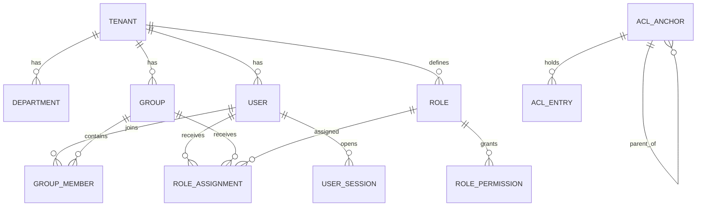
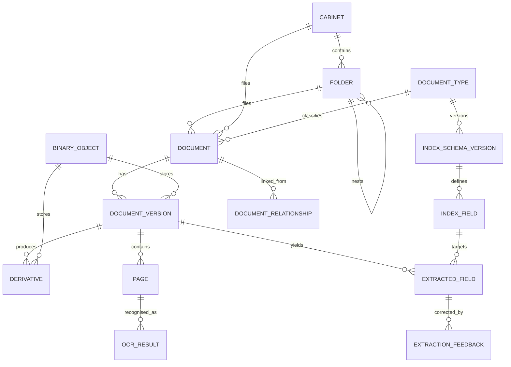
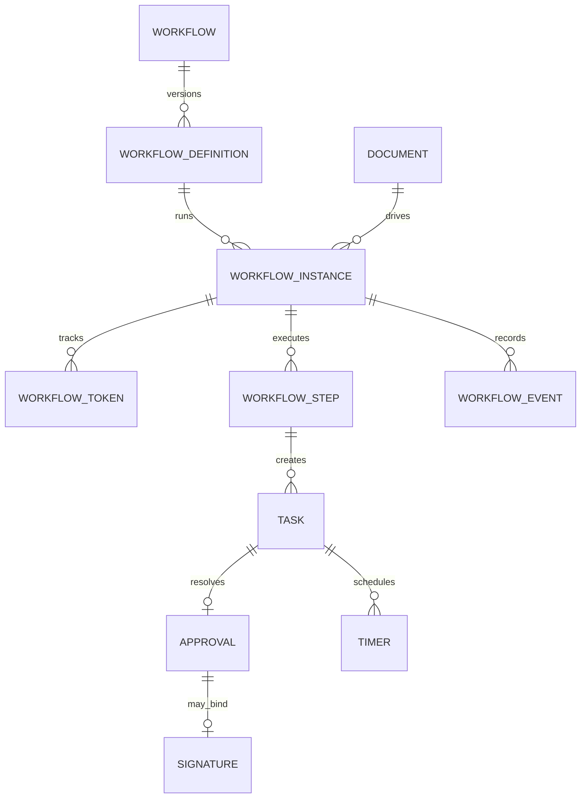

# DocuFlow domain model

**Status:** Accepted on 2026-11-06. Tables are created by feature-specific migrations, not all at once.

## Conventions

| Rule | Detail |
|---|---|
| Identifiers | UUIDv7 primary keys, which sort by time and keep indexes efficient |
| Tenancy | `tenant_id` on every tenant-owned table, with row-level security |
| Time | `timestamptz` in UTC; display uses the tenant or user time zone |
| Concurrency | `row_version` on records edited by people, using optimistic locking |
| Deletion | Soft delete only where stated; audit and disposal records are never deleted |
| JSONB | Only for truly flexible data: workflow definitions, form schemas, adapter settings |
| Status fields | PostgreSQL text with `CHECK` constraints, so adding a value is a simple migration |

## Core relationships

### Identity and permissions

### Repository and documents

### Workflow and tasks

## Entity catalogue

### Platform (M0)

| Table | Purpose | Key fields |
|---|---|---|
| `tenant` | Organization | `name`, `status`, `timezone`, `permission_epoch` |
| `system_config` | Typed configuration | `key`, `value`, `scope` |
| `processing_job` | Job truth | `type`, `status`, `attempts`, `progress`, `idempotency_key`, `heartbeat_at`, `last_error` |
| `ingestion_job` | Upload or import batch | `source`, `status`, `submitted_by`, `file_count` |
| `outbox` | Reliable events and job dispatch | `topic`, `payload`, `published_at` |
| `timer` | Durable scheduled action | `fire_at`, `kind`, `target_id`, `status` |
| `audit_event` | Tamper-evident trail | `seq`, `actor_id`, `action`, `object_type`, `object_id`, `before_after`, `result`, `ip`, `device`, `correlation_id`, `prev_hash`, `hash` |
| `audit_checkpoint` | External chain anchor | `seq`, `head_hash`, `object_key` |

### Identity (F01)

| Table | Purpose | Key fields |
|---|---|---|
| `department` | HR, Finance and so on | `name`, `parent_id` |
| `user` | Person or service identity | `email`, `password_hash`, `status`, `kind`, `department_id`, `mfa_enabled` |
| `group`, `group_member` | Groups and membership | `name`; `group_id`, `user_id` |
| `role`, `role_permission` | Configurable roles | `name`; `role_id`, `permission` |
| `role_assignment` | Role given to user or group | `role_id`, `user_id` or `group_id` |
| `permission` | Catalogue of system permissions | `code`, `description` |
| `acl_anchor` | Node with explicit ACL | `resource_type`, `resource_id`, `parent_anchor_id` |
| `acl_entry` | Allow or deny entry | `anchor_id`, `principal_type`, `principal_id`, `permission`, `effect` |
| `document_type_restriction` | Type-level deny | `document_type_id`, `principal_type`, `principal_id`, `permission` |
| `user_session` | Revocable session | `token_hash`, `device`, `ip`, `expires_at`, `revoked_at` |
| `mfa_credential`, `mfa_recovery_code` | TOTP and recovery | `secret_encrypted`; `code_hash`, `used_at` |
| `oidc_provider`, `oidc_identity` | SSO | `issuer`, `client_id`, `group_mapping`; `subject`, `user_id` |
| `api_key` | Machine access | `key_hash`, `prefix`, `scopes`, `service_user_id`, `expires_at` |

### Repository (F02)

| Table | Purpose | Key fields |
|---|---|---|
| `cabinet` | HR, Finance, Legal and so on | `name`, `description`, `status`, `retention_policy_id`, `acl_anchor_id` |
| `cabinet_document_type` | Allowed types | `cabinet_id`, `document_type_id` |
| `folder` | Nested folders (see [ADR 0016](../adr/0016-folder-hierarchy-and-anchors.md)) | `cabinet_id`, `parent_id`, `name`, `depth`, `status`, `acl_anchor_id`, `row_version` |
| `filing_rule` | Automatic routing | `condition`, `target_folder_template`, `priority` |
| `tag`, `document_tag` | Labels | `name`; `document_id`, `tag_id` |

### Documents (F03 to F05, F09)

| Table | Purpose | Key fields |
|---|---|---|
| `binary_object` | Stored bytes | `sha256`, `size`, `mime`, `object_key`, `wrapped_data_key`, `ref_count` |
| `document` | Stable identity | `cabinet_id`, `folder_id`, `document_type_id`, `title`, `status`, `acl_anchor_id`, `current_version_id`, `retention_class_id`, `row_version` |
| `document_version` | Immutable version | `document_id`, `number`, `binary_object_id`, `created_by`, `reason`, `state` (`quarantined`, `released`, `rejected`) |
| `derivative` | OCR, preview, compressed outputs | `version_id`, `kind`, `binary_object_id`, `source_derivative_id`, `producer`, `producer_version`, `params` |
| `page` | Per-page facts | `version_id`, `number`, `width`, `height`, `has_native_text`, `language`, `is_blank`, `content_class` |
| `quarantine_item` | Held files | `version_id`, `reason`, `scanner`, `signature`, `released_by` |
| `document_attachment` | Attached files | `document_id`, `attached_document_id`, `kind` |
| `document_relationship` | Invoice to PO links | `from_document_id`, `to_document_id`, `relation_type` |
| `duplicate_link` | Matches | `document_id`, `duplicate_of_id`, `method`, `score` |
| `tray_item` | User or group inbox | `owner_type`, `owner_id`, `document_id`, `state` |
| `capture_source` | Watch folder, mailbox, scanner | `kind`, `settings`, `target_folder_id`, `status` |

### Text and indexing (F04, F06, F07)

| Table | Purpose | Key fields |
|---|---|---|
| `ocr_result` | Page recognition | `page_id`, `engine`, `engine_version`, `language`, `text`, `boxes`, `confidence`, `duration_ms` |
| `document_type` | Supplier Invoice and so on | `name`, `status`, `current_schema_version_id`, `auto_accept_threshold`, `review_threshold` |
| `index_schema_version` | Immutable field set | `document_type_id`, `version` |
| `index_field` | Field definition | `schema_version_id`, `key`, `label`, `data_type`, `required`, `read_only`, `source`, `validation`, `visibility_rule`, `default_value`, `calculation` |
| `field_choice` | Dropdown values | `field_id`, `value`, `label` |
| `extraction_rule` | Regex and label anchors | `field_id`, `kind`, `definition`, `priority` |
| `classification_result` | Type proposal | `version_id`, `document_type_id`, `method`, `model_version`, `confidence` |
| `extracted_field` | Candidate with evidence | `version_id`, `field_id`, `raw_value`, `normalized_value`, `confidence`, `method`, `model_version`, `page_id`, `char_start`, `char_end`, `bbox`, `validation_state` |
| `extracted_table_row` | Line items | `version_id`, `table_key`, `row_number`, `cells`, `confidence`, `page_id` |
| `index_value` | Final saved value | `document_id`, `field_id`, `value_text`, `value_number`, `value_date`, `value_bool`, `validated_by` |
| `review_item` | Human queue | `version_id`, `reason`, `assigned_to`, `state` |
| `extraction_feedback` | Correction record | `extracted_field_id`, `before_value`, `after_value`, `corrected_by` |
| `learned_template` | Versioned learning | `document_type_id`, `scope_key`, `definition`, `version`, `confirmations`, `status` |
| `master_data_set`, `master_data_record` | Suppliers, customers, employees | `name`, `source`; `external_id`, `attributes` |

Reference fields and master data link through `index_value`, which also covers Scenario B's link between documents and employee records.

### Search (F08)

| Table | Purpose | Key fields |
|---|---|---|
| `search_chunk` | Page-level index and embedding store | `document_id`, `version_id`, `page_id`, `text`, `tsv`, `embedding`, `embedding_model`, `acl_anchor_id`, `document_type_id` |
| `saved_search` | Reusable queries | `owner_id`, `name`, `query`, `shared` |

### Collaboration (F10)

| Table | Purpose | Key fields |
|---|---|---|
| `task` | Work item | `document_id`, `workflow_step_id`, `title`, `priority`, `status`, `assignee_id`, `group_id`, `due_at`, `sla_policy_id`, `delegated_from_id` |
| `comment`, `mention` | Discussion | `document_id`, `author_id`, `body`; `comment_id`, `user_id` |
| `annotation` | Viewer layer | `version_id`, `page_id`, `kind`, `geometry`, `author_id` |
| `document_share` | Controlled sharing | `document_id`, `grantee_type`, `grantee_id`, `permissions`, `expires_at`, `token_hash` |

### Workflow (F11)

| Table | Purpose | Key fields |
|---|---|---|
| `workflow` | Named process | `name`, `status`, `is_template` |
| `workflow_definition` | Immutable published version | `workflow_id`, `version`, `graph` |
| `workflow_trigger` | Start condition | `definition_id`, `event`, `condition` |
| `workflow_instance` | Running process | `definition_id`, `document_id`, `status`, `context`, `row_version` |
| `workflow_token` | Position in graph | `instance_id`, `node_id`, `status`, `parent_token_id` |
| `workflow_step` | Node execution | `instance_id`, `node_id`, `status`, `attempts`, `error` |
| `workflow_event` | Every transition | `instance_id`, `from_node`, `to_node`, `actor_id`, `kind` |
| `delegation` | Proxy rules | `from_user_id`, `to_user_id`, `starts_at`, `ends_at` |

### Forms (F12)

| Table | Purpose | Key fields |
|---|---|---|
| `form`, `form_version` | Form and schema | `name`, `audience`; `schema`, `version` |
| `form_submission` | Submitted data | `form_version_id`, `data`, `document_id`, `workflow_instance_id`, `submitter_id` |

### Notifications (F13)

| Table | Purpose | Key fields |
|---|---|---|
| `notification` | In-app or email item | `user_id`, `kind`, `idempotency_key`, `read_at` |
| `notification_delivery` | Delivery attempts | `notification_id`, `channel`, `status`, `attempts`, `error` |
| `notification_template` | Message templates | `kind`, `channel`, `locale`, `body` |
| `sla_policy`, `business_calendar`, `holiday` | Due-date rules | `duration`, `reminder_before`; `timezone`, `hours`; `date` |

### Signatures (F14)

| Table | Purpose | Key fields |
|---|---|---|
| `approval` | Decision | `task_id`, `decider_id`, `decision`, `version_id`, `version_hash`, `reason` |
| `signature` | Attestation or provider signature | `approval_id`, `kind`, `provider`, `provider_reference`, `bound_hash`, `status`, `invalidated_at` |
| `signature_event` | Provider callbacks | `signature_id`, `event`, `payload_hash` |
| `stamp`, `stamp_application` | Templates and uses | `template`; `stamp_id`, `version_id`, `derivative_id`, `position` |

`signature.kind` always distinguishes `internal_attestation` from `external_esignature`.

### Records and privacy (F15, F16)

| Table | Purpose | Key fields |
|---|---|---|
| `retention_policy`, `retention_class` | Schedules | `name`; `duration`, `trigger`, `action_after` |
| `retention_state` | Per-document calculation | `document_id`, `eligible_at`, `status` |
| `legal_hold`, `legal_hold_item` | Holds | `name`, `reason`, `status`; `hold_id`, `document_id`, `folder_id` |
| `disposal_review`, `disposal_event` | Review and permanent record | `document_id`, `reviewer_id`, `decision`; `document_id`, `sha256`, `policy`, `approver_id` |
| `data_subject_request` | Privacy operations | `kind`, `subject_reference`, `status`, `blocked_reason` |
| `data_inventory_item` | Processing inventory | `category`, `legal_basis`, `location` |
| `access_review`, `access_review_item` | Periodic certification | `status`; `user_id`, `decision` |

### Compression (F17)

| Table | Purpose | Key fields |
|---|---|---|
| `compression_profile` | Versioned settings | `name`, `version`, `parameters`, `gate_thresholds` |
| `compression_run` | One attempt | `version_id`, `profile_id`, `derivative_id`, `status`, `recommended` |
| `compression_evaluation` | Run metrics | `run_id`, `original_size`, `derivative_size`, `ratio`, `reduction_pct`, `duration_ms`, `ssim_min`, `psnr_min`, `ocr_before`, `ocr_after`, `gate_result`, `source_hash`, `derivative_hash`, `algorithm_versions` |
| `compression_page_metric` | Worst-page evidence | `evaluation_id`, `page_number`, `content_class`, `ssim`, `psnr`, `strategy` |
| `evaluation_dataset`, `evaluation_dataset_item` | Research sets | `name`; `document_id`, `ground_truth` |

### AI (F18)

| Table | Purpose | Key fields |
|---|---|---|
| `ai_provider_config` | Tenant provider | `kind`, `model`, `settings`, `external_allowed` |
| `ai_conversation`, `ai_message` | Interaction metadata | `user_id`; `role`, `content` (policy-dependent), `model` |
| `ai_citation` | Evidence | `message_id`, `document_id`, `version_id`, `page_number`, `chunk_id` |

### Integrations and operations (F19 to F21)

| Table | Purpose | Key fields |
|---|---|---|
| `integration` | Connector settings | `kind`, `settings_encrypted`, `status` |
| `webhook_subscription`, `webhook_delivery` | Outbound events | `url`, `events`, `secret_encrypted`; `event_id`, `status`, `attempts`, `signature` |
| `idempotency_record` | Retry-safe writes | `key`, `request_hash`, `response` |
| `export_job`, `backup_run`, `restore_drill` | Portability and recovery | `scope`, `manifest_hash`; `status`, `hashes`; `duration`, `result` |

## Requirement coverage from guide section 6

| Required concept | Table |
|---|---|
| Tenants, users, groups, roles, permissions, departments | `tenant`, `user`, `group`, `role`, `permission`, `acl_entry`, `department` |
| Document types, index schemas and fields | `document_type`, `index_schema_version`, `index_field` |
| Documents, versions, binaries, derivatives | `document`, `document_version`, `binary_object`, `derivative` |
| OCR, extracted fields, classification, confidence | `ocr_result`, `extracted_field`, `classification_result`, `confidence` columns |
| Tags, folders, repositories, relationships, attachments | `tag`, `folder`, `cabinet`, `document_relationship`, `document_attachment` |
| Comments, annotations | `comment`, `annotation` |
| Workflows, definitions, instances, steps | `workflow`, `workflow_definition`, `workflow_instance`, `workflow_step` |
| Tasks, approvals, signatures, stamps | `task`, `approval`, `signature`, `stamp` |
| Notifications | `notification` |
| Retention, legal holds, disposal | `retention_policy`, `legal_hold`, `disposal_event` |
| Audit, API keys, integrations | `audit_event`, `api_key`, `integration` |
| Ingestion and processing jobs | `ingestion_job`, `processing_job` |
| Compression evaluations | `compression_evaluation` |
| Search indexes and embeddings | `search_chunk` |
| AI conversations and citations | `ai_conversation`, `ai_citation` |
| System configuration | `system_config` |
